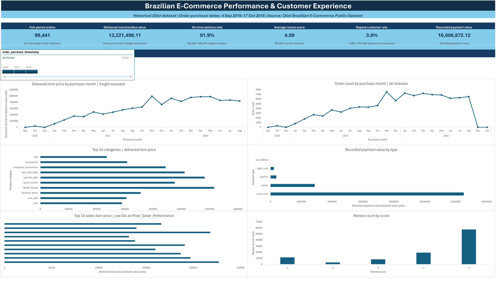

# Brazilian E-Commerce Performance and Customer Experience Analysis

An Excel portfolio project exploring historical order, product, payment, delivery, seller, and review data from the Olist Brazilian E-Commerce Public Dataset.

> **Historical scope:** The analyzed order purchase dates run from 4 September 2016 to 17 October 2018. These findings describe the dataset period and do not represent current market conditions.

## Dashboard

The executive dashboard reports order volume, delivered item value, on-time delivery, average review score and repeat-purchase share, with PivotCharts breaking the same records down by product category, seller and payment type.

## Project files

| File | Description |
|------|-------------|
| [Excel analysis workbook](https://github.com/RojanDA/list-ecommerce-performance-customer-experience/releases/download/v1.0.0/Olist_Ecommerce_Analysis.xlsx) | The full analysis workbook (~107 MB). Hosted as a release asset because it exceeds GitHub's 100 MB per-file limit. |
| [dashboard.png](dashboard.png) | Screenshot of the executive dashboard |
| [Full project documentation](Olist_Ecommerce_Project_Documentation.docx) | Method, data model, validation checks and findings |
| [Project presentation](Olist_Ecommerce_Project_Presentation_Final.pptx) | 13-slide summary of the project |
| [`data/`](data/) | The nine source CSVs, included so the workbook can be rebuilt |

### Source data (`data/`)

| File | Rows | Grain |
|------|------|-------|
| `olist_orders_dataset.csv` | 99,441 | One row per order; status and lifecycle timestamps |
| `olist_order_items_dataset.csv` | 112,650 | One row per item line in an order |
| `olist_customers_dataset.csv` | 99,441 | Per-order customer location; includes `customer_unique_id` |
| `olist_order_payments_dataset.csv` | 103,886 | One payment record per sequence; an order can have several |
| `olist_order_reviews_dataset.csv` | 99,224 | Review records and scores |
| `olist_products_dataset.csv` | 32,951 | One row per product |
| `olist_sellers_dataset.csv` | 3,095 | One row per seller |
| `olist_geolocation_dataset.csv` | 1,000,163 | Postal-prefix coordinates; not used for dashboard KPIs |
| `product_category_name_translation.csv` | 71 | Portuguese-to-English category lookup |

Keeping these at separate grains matters: a careless one-to-many join would multiply item price and order counts, which is why the workbook builds six Data Model relationships on unique lookup keys and verifies each join separately.

## What I did

- Prepared the related CSV tables with Excel Power Query while preserving the original source files.
- Modeled the tables at their appropriate record grain using the Excel Data Model.
- Checked row counts, key fields, joins, and totals to reduce the risk of accidentally multiplying order or item values.
- Built PivotTables, PivotCharts, and an interactive dashboard to explore the historical records.

## Selected verified findings

- The dataset contains **99,441 orders** across recorded order statuses.
- Delivered item price totaled **13,221,498.11 dataset value units**, excluding freight. This is not profit or audited revenue.
- **91.9%** of eligible delivered orders arrived on or before the estimated date: 88,644 of 96,470. Eight delivered orders with no actual delivery timestamp were excluded from this rate.
- The average review score was **4.09 out of 5** across 99,224 review records.
- **3.0%** of delivered customers had at least two distinct delivered orders within the observed dataset window. This is not a long-term retention rate.

Payment value is a separate measure from delivered item price because it comes from a different table and record grain. The project documentation explains the metric definitions, data limitations, validation checks, and interpretation.

## Tools

Microsoft Excel 365, Power Query, Excel Data Model, PivotTables, PivotCharts, and slicers.

## Data source

[Olist Brazilian E-Commerce Public Dataset on Kaggle](https://www.kaggle.com/datasets/olistbr/brazilian-ecommerce)

The source records cover 2016–2018, with partial first and last calendar years. Results are descriptive and do not establish cause and effect. The source CSVs are included in [`data/`](data/); if you refresh the workbook after downloading it, its Power Query source path may need to be updated to the folder where you saved those files.
